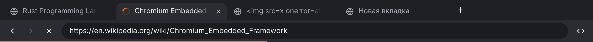

# Rustium

Прототип браузера на **Rust + CEF** (Chromium Embedded Framework): тот же
Chromium, что в Chrome, Arc и Dia, а вокруг него своя оболочка. Ядро
написано на Rust, интерфейс (вкладки и адресная строка) — на HTML/CSS/JS.



Что уже есть:

- вкладки: открыть, закрыть, переключить; узкий режим, когда вкладок много;
- адресная строка: URL, `localhost:3000` и IP открываются как адреса,
  остальное уходит в поиск DuckDuckGo;
- назад/вперёд, обновить/остановить, полоса загрузки, favicon,
  индикатор загрузки во вкладке;
- `target=_blank`, `window.open`, Ctrl/Cmd+клик и средняя кнопка
  открывают новую вкладку;
- своя страница ошибки (нет сети, сертификат) и падения вкладки;
- DevTools (F12), масштаб, горячие клавиши;
- постоянный профиль: cookies и localStorage сохраняются между запусками.

## Требования

- Rust stable (проверено на 1.97).
- **Linux** (x86_64/arm64): системные библиотеки Chromium. Для Ubuntu 24.04:
  ```sh
  sudo apt install libnss3 libatk1.0-0t64 libatk-bridge2.0-0t64 libcups2t64 \
    libdrm2 libxkbcommon0 libxcomposite1 libxdamage1 libxrandr2 libgbm1 \
    libpango-1.0-0 libcairo2 libasound2t64 libgtk-3-0t64
  ```
  Если окно не запускается, проверьте, каких библиотек не хватает:
  `ldd target/debug/libcef.so | grep "not found"`.
- **macOS** 11+: Xcode Command Line Tools, а также `brew install cmake ninja`
  (нужны для сборки `libcef_dll_wrapper`).

При первой сборке `cef-dll-sys` скачивает CEF 156 (≈ 150–300 МБ) с
`cef-builds.spotifycdn.com`. Чтобы не качать его заново после `cargo clean`,
можно один раз положить CEF в общую папку:

```sh
cargo install export-cef-dir@156.4.0
export-cef-dir --force "$HOME/.local/share/cef"
export CEF_PATH="$HOME/.local/share/cef"      # добавьте в ~/.zshrc / ~/.bashrc
```

## Запуск

**Linux:**

```sh
cargo run                       # debug; файлы CEF уже лежат рядом в target/debug
# или отдельная папка со всем нужным:
cargo run --bin bundle -- --release
./target/bundle/rustium
```

**macOS:** CEF работает только из `.app`-бандла с helper-процессами.

```sh
cargo run --bin bundle
open target/bundle/rustium.app
# с логами в терминале:
./target/bundle/rustium.app/Contents/MacOS/rustium
```

### Переменные окружения

| Переменная | Что делает |
|---|---|
| `RUSTIUM_PROFILE=/path` | Папка профиля. По умолчанию `~/.local/share/rustium` (Linux) или `~/Library/Application Support/Rustium` (macOS) |
| `RUSTIUM_DEBUG_PORT=9222` | Удалённая отладка: `chrome://inspect`, Playwright `connectOverCDP` |
| `RUSTIUM_SANDBOX=1` | Linux: включить песочницу Chromium (нужен настроенный `chrome-sandbox`) |
| `RUSTIUM_DOWNLOADS_DIR=/path` | Папка загрузок вместо `~/Downloads` (удобно для проверок) |

## Горячие клавиши

«Главная» клавиша — **⌘** на macOS и **Ctrl** на Linux.

| Сочетание | Действие |
|---|---|
| ⌘/Ctrl+T | Новая вкладка |
| ⌘/Ctrl+W | Закрыть вкладку |
| ⌘/Ctrl+L | Адресная строка |
| ⌘/Ctrl+R, F5 | Обновить |
| Ctrl+Tab / Ctrl+Shift+Tab | Следующая / предыдущая вкладка |
| ⌘/Ctrl+1…8, ⌘/Ctrl+9 | Вкладка по номеру / последняя |
| Alt+← / Alt+→ (Linux), ⌘[ / ⌘] (macOS) | Назад / вперёд |
| F12, Ctrl+Shift+I, ⌘⌥I | DevTools |
| ⌘/Ctrl + `+` / `-` / `0` | Масштаб |
| ⌘Q (macOS) | Выход |

## Как устроено

```
┌───────────────────────── Window (CEF Views, Alloy) ─────────────────────────┐
│ BrowserView: ui/toolbar.html (data: URL)  ── cefQuery ──►  ipc.rs           │
│                                           ◄── execute_java_script ── shell.rs│
├──────────────────────────────────────────────────────────────────────────────┤
│ Panel (FillLayout): BrowserView вкладки 1 │ вкладки 2 │ …  (видна активная)  │
└──────────────────────────────────────────────────────────────────────────────┘
```

| Файл | Роль |
|---|---|
| `src/app.rs` | `CefApp`, настройки, запуск; renderer-процесс внедряет `cefQuery` только в панель |
| `src/shell.rs` | Состояние (окно, вкладки) и все действия: открыть/закрыть/переключить, навигация |
| `src/client.rs` | Обработчики событий браузеров: заголовок, URL, загрузка, всплывающие окна, закрытие |
| `src/views.rs` | Делегаты окна и BrowserView (раскладка, высота панели, Alloy-стиль) |
| `src/ipc.rs` | Протокол панели: JSON-команды и JSON-состояние |
| `src/shortcuts.rs` | Горячие клавиши |
| `src/urlfix.rs` | Что делать с введённым текстом: адрес или поиск |
| `src/mac.rs` | macOS: загрузка фреймворка, подкласс `NSApplication` для CEF |
| `ui/toolbar.html` | Интерфейс панели. Можно менять как обычную веб-страницу |
| `ui/newtab.html` | Страница новой вкладки |

**Протокол панели.** Панель отправляет `window.cefQuery({request: '{"cmd":"navigate","url":"..."}'})`.
Команды: `ready`, `navigate`, `back`, `forward`, `reload`, `stop`, `newTab`,
`closeTab`, `selectTab`, `focusContent`, `devTools`. Rust в ответ вызывает
`window.rustium.update({tabs, active})` и `window.rustium.focusAddress()`.

**Безопасность.** `cefQuery` появляется только в главном фрейме браузера
панели: его помечает `extra_info`, а Rust дополнительно проверяет
отправителя. Сайты во вкладках управлять браузером не могут. Панель нельзя
увести на другой адрес, а `javascript:` из адресной строки не выполняется.

## Проверки без CEF

```sh
cargo check --features cef/dox --all-targets   # проверка типов без скачивания CEF
cargo test  --features cef/dox --lib           # юнит-тесты (URL, IPC, base64)
node scripts/ui-test.js                        # панель в Chrome через Playwright
```

## Ограничения прототипа

- Загрузки файлов отменяются: нет `DownloadHandler`.
- Запросы разрешений (камера, геолокация, уведомления) отклоняются.
- Расширений Chrome нет: для них нужен Chrome-стиль CEF, а он несовместим
  с несколькими BrowserView в одном окне.
- `window.open` открывает обычную вкладку без связи с opener, поэтому
  OAuth-окна, которые пишут в `window.opener`, работать не будут.
- Нет истории, закладок и восстановления сессии.
- На Linux по умолчанию выключена песочница (см. `RUSTIUM_SANDBOX`).
- На macOS в debug-сборке включён `--use-mock-keychain`, поэтому cookies
  шифруются фиксированным ключом.

Следующие шаги — в `CLAUDE.md`.
